# Directorio de Negocios de Dolores Hidalgo · API local

## Pruebas y evidencias

### Captura 1 · Servidor en ejecución y registro de peticiones

La terminal muestra las peticiones recibidas: `GET /negocios`, `POST /negocios` y `DELETE /negocios/6`.

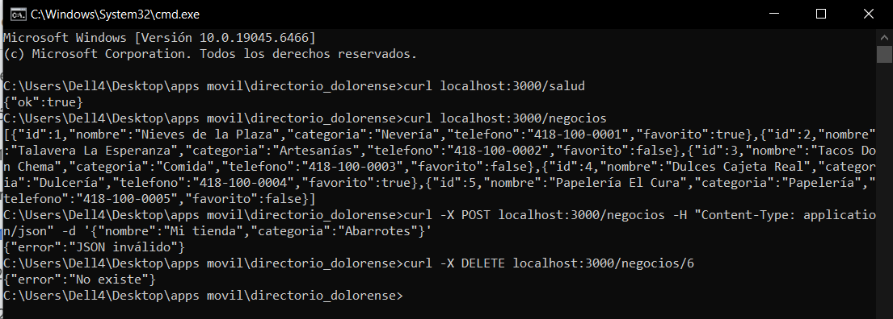

### Captura 2 · Creación de negocio (POST)

`Invoke-RestMethod` envía un negocio válido y la API responde con el registro y su `id` asignado.

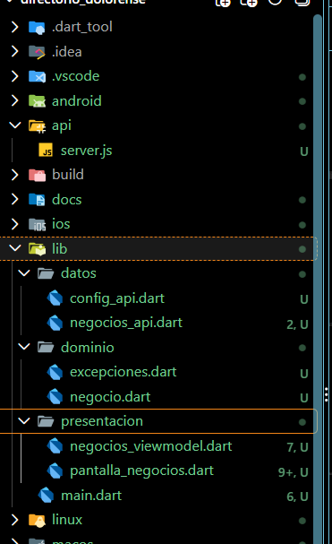

### Captura 3 · Lista de negocios en el navegador

Consulta a `http://localhost:3000/negocios`. Se muestran los 5 negocios iniciales en JSON.

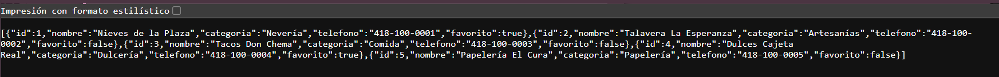

### Captura 10 · Eliminación (DELETE)

`curl.exe -i -X DELETE localhost:3000/negocios/6` responde `204 No Content`, sin cuerpo.

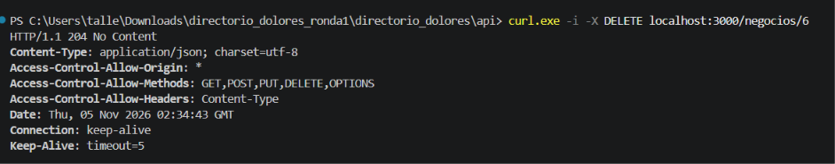

## Estructura del proyecto

```
directorio_dolores/
├── api/
│   └── server.js
└── docs/
    └── capturas/
```

## TDD desde el paso 2.2

### 2.2 · Modelo `Negocio`

#### Rojo

Las pruebas especifican la lectura de los campos JSON, los valores predeterminados de `telefono` y `favorito`, la omisión de `id` al serializar un negocio nuevo y la copia que cambia solo el favorito. Fallan porque la implementación de `Negocio` está comentada: Dart no encuentra la clase ni sus métodos. Esto confirma que las pruebas detectan el comportamiento todavía ausente.
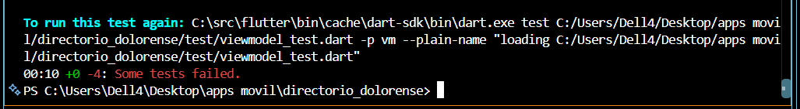

#### Verde

Al habilitar la clase, el constructor y los métodos `desdeJson`, `aJson` y `copiarCon`, el modelo cumple las expectativas. Las pruebas pasan porque cada entrada y operación produce los valores requeridos.
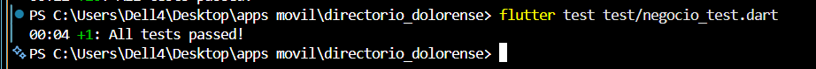
### 2.3 · Excepciones del dominio

#### Rojo

Las pruebas de errores fallan si no existen las excepciones esperadas o si una excepción no conserva información como el código HTTP. Así se muestra que el cliente todavía no puede comunicar los distintos tipos de fallo de forma reconocible.
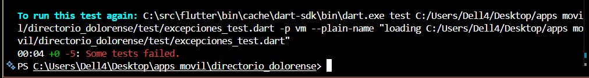
#### Verde

Pasan cuando hay excepciones diferenciadas para falta de conexión, error del servidor y respuesta inválida, y cada una conserva los datos que necesita quien la maneja.
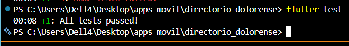

### 3.1 · Cliente HTTP y listado

#### Rojo

La prueba usa `MockClient` para revisar el método, la ruta y la conversión del JSON. Falla si el cliente no existe, construye una petición distinta de `GET /negocios` o no convierte la respuesta en objetos `Negocio`.
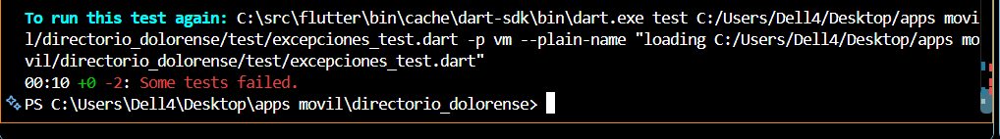

#### Verde

Pasa cuando el cliente envía la petición esperada y transforma cada elemento de la respuesta JSON en un modelo `Negocio`. El mock permite comprobarlo sin depender del servidor ni de la red.
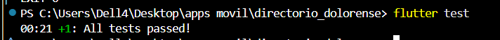


### 3.2 · Manejo de errores

#### Rojo

Las pruebas fallan si una respuesta 500, una desconexión o un JSON inválido se propagan sin tratarse o se convierten en una excepción equivocada.
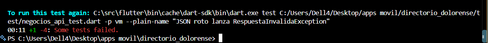

#### Verde

Pasan cuando cada condición produce la excepción de dominio correspondiente y el error HTTP conserva su código. Así, las capas superiores pueden distinguir qué ocurrió.
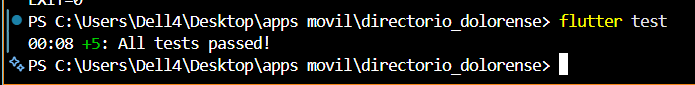

### 3.3 · Crear, buscar, actualizar y eliminar

#### Rojo

Las pruebas fallan si las operaciones usan un método o una ruta incorrectos, omiten parámetros o encabezados, envían un cuerpo JSON inesperado o no aceptan correctamente una respuesta 204 sin cuerpo.
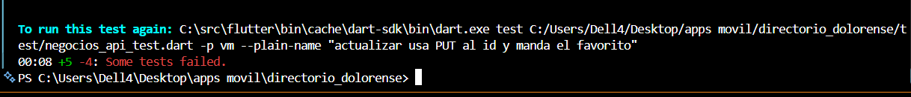

#### Verde

Pasan cuando cada operación cumple su contrato HTTP y las respuestas exitosas se interpretan correctamente. El mock verifica solicitudes y respuestas sin llamar a una API externa.
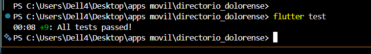

### 4 · Conexión con la API local

#### Rojo

La integración falla si la URL no corresponde al entorno, el servidor no está accesible o la plataforma bloquea el tráfico HTTP local. Los tests con `MockClient` no detectan esos problemas porque no establecen una conexión real.
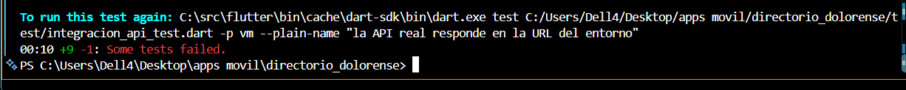

#### Verde

La conexión funciona cuando la app usa la dirección adecuada para el emulador, escritorio o celular, el servidor está disponible y la plataforma permite la solicitud local.
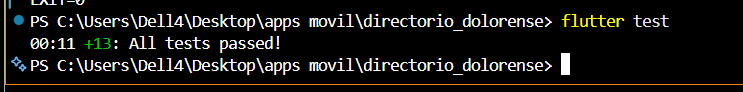

### 5.1 · ViewModel y estados

#### Rojo

Las pruebas fallan si el ViewModel omite estados, notifica una transición incorrecta o no representa una respuesta vacía o un error.
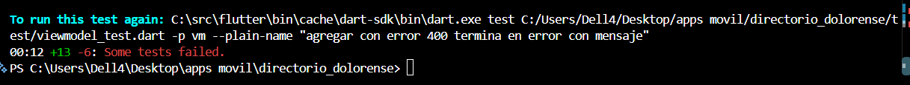

#### Verde

Pasan cuando el ViewModel comunica correctamente los estados inicial, cargando, listo, vacío y error según el resultado, y permite reintentar cuando corresponde.
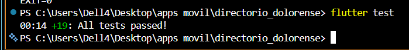

### 6.1 · Pantalla de negocios

#### Rojo

Las pruebas de widgets fallan si la pantalla no refleja el estado recibido, muestra contenido incorrecto o no ofrece la interacción esperada, como reintentar después de un error.
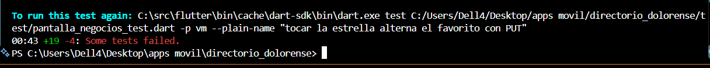

#### Verde

Pasan cuando cada estado del ViewModel se representa con la vista correspondiente y las acciones de la pantalla están conectadas.
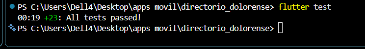

